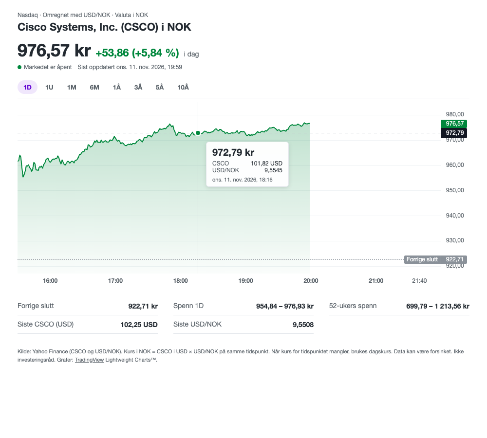

# CSCO i NOK

A small Yahoo Finance-style web page that shows the Cisco Systems (CSCO) share price converted to Norwegian kroner, using the USD/NOK exchange rate at the same point in time. The user interface is in Norwegian.



## Features

- Price chart in NOK for 1D, 1U, 1M, 6M, 1Å, 3Å, 5Å and 10Å
- Hover tooltip with the NOK price, plus the CSCO price in USD and the USD/NOK rate used
- Header with the latest NOK price and the change for the selected period
- Stats panel: start price (or previous close on 1D), range for the selected period, 52-week range, latest CSCO and USD/NOK
- 1D refreshes every minute while the US market is open
- Runs on an ordinary PHP web hotel: no database, no build step, no Node.js

## How it works

```
browser (index.html + assets/app.js)
   │  GET api/data.php?range=6m
   ▼
api/data.php ──► cache/*.json ──► Yahoo Finance (when the cache has expired)
```

The browser can't fetch from Yahoo directly because Yahoo blocks cross-site requests, so a small PHP endpoint does the fetching, caching and currency conversion, and returns JSON that the page draws with [Lightweight Charts](https://github.com/tradingview/lightweight-charts).

### Data

Both series come from Yahoo Finance's chart endpoint: `CSCO` for the share price and `NOK=X` for USD/NOK.

| Range | Bar size |
| --- | --- |
| 1D | 1 minute |
| 1U | 5 minutes |
| 1M | 30 minutes |
| 6M – 10Å | 1 day |

### Currency conversion

Each CSCO price is multiplied by a USD/NOK rate:

- **Intraday:** the latest USD/NOK bar at or before the CSCO bar, on the same trading day. If a day has no intraday rates, that day's daily rate is used for the whole day (shown as "dagskurs" in the tooltip).
- **Daily:** the USD/NOK close on the same date. If that date has no rate, the nearest date is used; on a tie, the earlier one.

### Caching

Data is stored as JSON files in `cache/`, one per symbol and bar size. The first request downloads 10 years of daily data and the available intraday history; after that only the most recent part is fetched and merged in, so history is never downloaded twice.

- **How long the cache lasts:** 1 minute for intraday data and 5 minutes for daily data while the US market is open, refreshing until shortly after the close. Outside trading hours it lasts 6 hours for intraday data and 1 hour for daily data.
- **How long data is kept:** intraday bars are kept longer than Yahoo provides them: 14 days for 1-minute, 90 days for 5-minute and 400 days for 30-minute bars. Daily bars are kept forever.
- **If Yahoo fails:** the cached data is served and the page shows a notice that the prices may be out of date.

## Requirements

- PHP 8.0 or newer with the `curl` extension
- Apache or LiteSpeed with `.htaccess` support, used to block access to `cache/`, `api/lib/` and `.git`
- A `cache/` folder that PHP can write to

## Deploying

### With git (recommended)

On a web hotel with SSH access, such as PRO ISP, clone the repository into the folder your domain serves:

```bash
ssh <ssh-username>@<server>
cd <web root>
git clone https://github.com/henrikba/csco-nok2.git csco
```

The page is then available at `https://<your-domain>/csco/`. To update:

```bash
cd csco && git pull
```

On PRO ISP, outgoing SSH from the server is blocked, so use the HTTPS clone URL as shown. Select PHP 8 for the site in the control panel.

### With FTP/SFTP

Upload everything except `.gitignore`, `README.md` and `docs/`, keeping the folder structure. Make sure the hidden `.htaccess` files are uploaded too, and that `cache/` is writable (permissions 755 or 775).

The cache fills on the first page view, which takes a few seconds.

## Running locally

```bash
php -S 127.0.0.1:8765
```

Then open <http://127.0.0.1:8765/>. PHP's built-in server ignores `.htaccess`, which is fine for local use.

## Project structure

```
index.html                 page layout
assets/app.js              chart, tooltip, formatting, range switching
assets/style.css           styling
assets/vendor/             Lightweight Charts (bundled, no CDN)
api/data.php               JSON endpoint: ?range=1d|1w|1m|6m|1y|3y|5y|10y
api/lib/yahoo.php          Yahoo Finance client
api/lib/cache.php          file cache with locking and incremental updates
api/lib/merge.php          USD/NOK matching and NOK conversion
api/lib/market.php         US market hours and date helpers
cache/                     cached data (created at runtime, not in git)
```

## Limitations

- Yahoo Finance's chart endpoint is unofficial and undocumented. It can change or rate-limit without notice.
- Market hours are worked out from the clock (09:30–16:00 New York time on weekdays). US holidays and half days aren't known in advance, though the "market open" indicator does check that a trading day actually has data.
- Prices may be delayed. This is not investment advice.

## Credits

Charts are drawn with [TradingView Lightweight Charts™](https://www.tradingview.com/lightweight-charts/), licensed under Apache 2.0. Copyright (c) 2025 TradingView, Inc. The license's attribution requirement is met by the link in the page footer.
